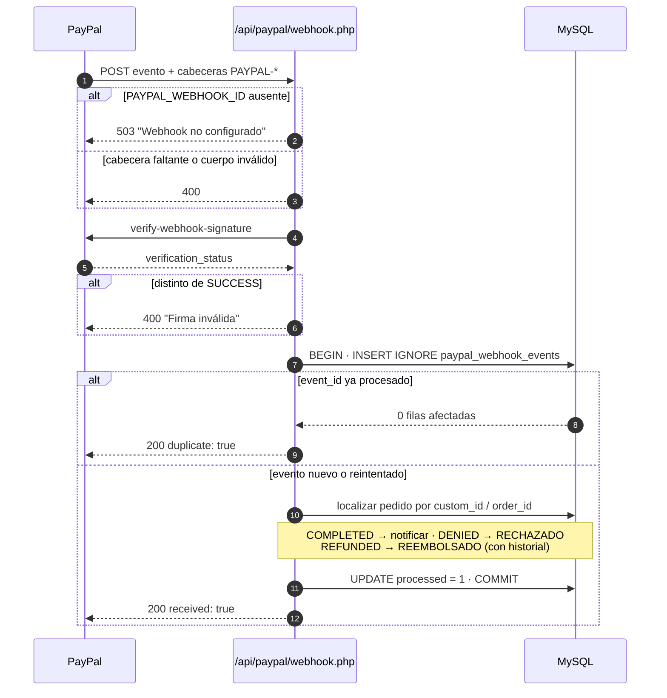
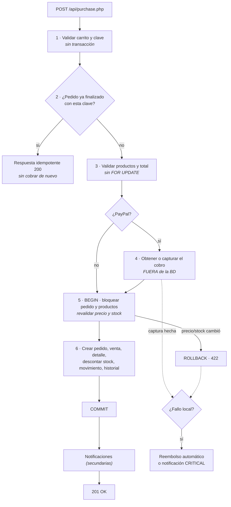
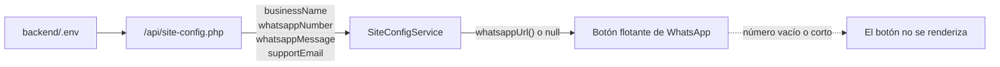

# Cambios del commit `6eb53ab` — Pagos reales, permisos por rol y catálogo comercial

> Nota de cambio · LiquorSoft · 2026-10-29

| Campo | Valor |
|---|---|
| **Commit** | `6eb53ab0ed2de382782e701d74f55224f93c25cf` |
| **Rama** | `main` (1 commit por delante de `origin/main`) |
| **Autor** | Rodni0101 |
| **Fecha** | 2026-10-29 02:13:37 (UTC-05:00) |
| **Mensaje original** | `Que se coma su mierda el TENA ya yo me canse resuelvan ustedes` |
| **Alcance** | 127 archivos · **+4 127 / −483** líneas |
| **Composición** | 54 imágenes binarias · 73 archivos de texto |
| **Por tipo** | 29 `.png`, 25 `.jpg`, 20 `.php`, 19 `.ts`, 12 `.html`, 11 `.css`, 4 `.sql`, 3 `.md`, 1 `.json`, 1 `.txt`, 1 `.template`, 1 `.example` |
| **Ver** | `git show 6eb53ab` |

---

## Índice

1. [En una página](#1-en-una-página)
2. [Acciones obligatorias](#2-acciones-obligatorias)
3. [Pagos: PayPal en vivo y conciliación](#3-pagos-paypal-en-vivo-y-conciliación)
4. [Checkout: nueva secuencia transaccional](#4-checkout-nueva-secuencia-transaccional)
5. [Seguridad y autorización por permisos](#5-seguridad-y-autorización-por-permisos)
6. [Base de datos y catálogo](#6-base-de-datos-y-catálogo)
7. [Panel de administración](#7-panel-de-administración)
8. [Configuración pública y contacto](#8-configuración-pública-y-contacto)
9. [Imágenes y paquete de despliegue](#9-imágenes-y-paquete-de-despliegue)
10. [Frontend y experiencia de uso](#10-frontend-y-experiencia-de-uso)
11. [Contratos de API que cambiaron](#11-contratos-de-api-que-cambiaron)
12. [Notas técnicas, riesgos y deuda](#12-notas-técnicas-riesgos-y-deuda)
13. [Lista de verificación](#13-lista-de-verificación)
14. [Documentación relacionada](#14-documentación-relacionada)

---

## 1. En una página

Este commit consolida tres frentes que venían pendientes:

| Frente | Qué obtiene el lector ahora | Antes |
|---|---|---|
| **Pagos** | PayPal puede operar en **`live`** (cobros reales), con **webhook verificado**, auditoría de eventos y **reembolso automático** si el pedido local falla después de cobrar | Solo sandbox; si se perdía la respuesta tras el cobro, el dinero quedaba cobrado sin pedido |
| **Autorización** | Acceso por **permisos por rol** (Supervisor, Vendedor, Bodega y Trabajador entran al panel con su alcance real); CSRF también en escrituras administrativas; cabeceras de seguridad en toda la API | Todo el panel exigía literalmente el rol `Administrador` |
| **Operación** | Catálogo real de **29 productos** con imágenes locales, usuarios con **baja lógica**, compras con múltiples líneas, inventario filtrable, alertas de stock ≤ 10 y botón de WhatsApp configurable por variable de entorno | Catálogo de ejemplo, borrado físico de usuarios, compras de un solo producto |

**Imagen del repositorio:** `public/images/productos/` pasó de **25 archivos / 196 MB** a **54 archivos / 37 MB** (29 PNG de catálogo + 25 JPG reoptimizados).

---

## 2. Acciones obligatorias

### 2.1 Antes de desplegar

- [ ] **Respaldar la base de datos** antes de tocar esquema.
- [ ] Instalación **nueva**: importar `backend/database/schema.sql`. **No** ejecutar ninguna migración.
- [ ] Instalación **existente**: aplicar en orden las migraciones nuevas:

  ```bash
  mysql -u USER -p DB < backend/database/migrations/016_product_featured.sql
  mysql -u USER -p DB < backend/database/migrations/017_real_catalog_refresh.sql
  mysql -u USER -p DB < backend/database/migrations/018_paypal_webhook_events.sql
  ```

  > `017` e `018` ya están reflejadas en `schema.sql` (ver [`DEPLOYMENT.md`](../../DEPLOYMENT.md)).
  > `017` es idempotente: no duplica productos ni reinicia stock existente.

- [ ] **PayPal:** crear el webhook en PayPal Developer apuntando a
  `https://TU-DOMINIO/api/paypal/webhook.php` con los eventos
  `PAYMENT.CAPTURE.COMPLETED`, `PAYMENT.CAPTURE.DENIED` y
  `PAYMENT.CAPTURE.REFUNDED`, y copiar su ID.
- [ ] **Variables de entorno nuevas** en `backend/.env` (ver §8):

  | Variable | Obligatoria | Efecto si se omite |
  |---|---|---|
  | `PAYPAL_WEBHOOK_ID` | Sí, si se usa PayPal | El webhook responde **503** y PayPal reintenta sin cesar |
  | `LIQUORSOFT_WHATSAPP_NUMBER` | No | El botón flotante **no se muestra** |
  | `LIQUORSOFT_WHATSAPP_MESSAGE` | No | Usa el mensaje por defecto |
  | `LIQUORSOFT_BUSINESS_NAME` | No | Usa `LiquorSoft` |
  | `LIQUORSOFT_SUPPORT_EMAIL` | No | Queda vacío |

- [ ] Regenerar `deploy/env.production.example` → `.env` real y
  `deploy/htaccess.txt` → `.htaccess` (ahora envían cabeceras de seguridad).

### 2.2 Después de desplegar

- [ ] `curl -s https://TU-DOMINIO/api/site-config.php` → debe incluir el número de WhatsApp.
- [ ] `curl -I https://TU-DOMINIO/api/` → debe incluir `X-Content-Type-Options`, `X-Frame-Options`, `Referrer-Policy`.
- [ ] `curl -I https://TU-DOMINIO/.env` → debe seguir devolviendo **403**.
- [ ] Recorrer el panel con un rol que **no** sea Administrador (p. ej. Vendedor) y comprobar que solo ve sus secciones.
- [ ] Con `PAYPAL_ENVIRONMENT=live`: la interfaz debe mostrar **“PayPal”** (no “PayPal Sandbox”), la compra debe ser real y el evento debe quedar en `paypal_webhook_events`.

### 2.3 Cambio de flujo local (desarrollo)

`LiquorSoft-angular/proxy.conf.json` apunta ahora a **`http://localhost:8080`**
(antes `8000`). Si tu servidor PHP local sigue en el 8000, ajusta el proxy o
arranca el backend en el 8080:

```bash
php -S 127.0.0.1:8080 -t backend
```

---

## 3. Pagos: PayPal en vivo y conciliación

### 3.1 Ambiente `live`

`backend/api/config/paypal.php` ahora acepta `PAYPAL_ENVIRONMENT=live` y
cambia la URL base:

| Ambiente | API | Dinero |
|---|---|---|
| `sandbox` | `https://api-m.sandbox.paypal.com` | De prueba |
| `live` | `https://api-m.paypal.com` | **Real** |

Cualquier otro valor sigue marcando `invalid_environment`. `GET /api/payment-config.php`
expone ahora `paypalEnvironment`, y el checkout usa ese dato para mostrar
**“PayPal / Pago seguro en USD”** en vivo frente a
**“PayPal Sandbox / Pago de prueba en USD”**.

> **Cuidado:** pasar a `live` es una operación de negocio, no un flag. Requiere
> credenciales Live, HTTPS, `LIQUORSOFT_COOKIE_SECURE=1`, webhook Live y una
> prueba con importe pequeño.

### 3.2 Webhook nuevo: `POST /api/paypal/webhook.php`

Archivo nuevo (245 líneas). Flujo:



**Garantías:**

- **Verificación de firma obligatoria** contra la API de PayPal antes de cualquier efecto.
- **Idempotencia** por `event_id` (clave única) dentro de la misma transacción:
  entregas concurrentes se serializan; una repetida responde `duplicate: true`
  sin repetir efectos.
- **Procesamiento transaccional:** si algo falla, se hace `rollback`, se guarda
  el error en la fila y queda `processed = 0`, de modo que **el reintento de
  PayPal vuelve a procesarlo**.
- **Reconciliación:** un `PAYMENT.CAPTURE.COMPLETED` sin pedido local genera
  una notificación `PAYPAL_RECONCILIACION` a administradores en lugar de
  perderse en silencio.

### 3.3 Reembolso automático de compensación

`paypalRefundCapture()` (nuevo en `config/paypal.php`) se invoca cuando el
cobro en PayPal **ya se completó** pero la transacción local no pudo finalizar
(precio/stock cambió). Antes el dinero quedaba cobrado sin pedido.

- Reembolso exitoso → respuesta **409** al cliente con mensaje de reintento.
- Reembolso fallido → log `CRITICAL` + notificación
  `PAYPAL_REEMBOLSO_FALLIDO` a administradores para reembolso manual, y
  respuesta **500** pidiendo contactar con el número de orden de PayPal.
- **Nunca** se reembolsa una captura que ya tiene una venta local confirmada
  (se verifica antes de actuar).

---

## 4. Checkout: nueva secuencia transaccional

`backend/api/purchase.php` (+358/−127) pasó de una sola transacción larga que
**mezclaba llamadas externas con bloqueos de base de datos** a una secuencia
por fases. `backend/api/paypal/create-order.php` se reordenó de la misma forma.



**Cambios concretos:**

- **Validación sin locks** en la fase 3: evita capturar un monto distinto al
  que se muestra al usuario.
- **Cobro fuera de la transacción**: la ventana con `FOR UPDATE` abierta ya no
  incluye latencia de red de PayPal.
- **Transacción local corta** (fases 5–6): solo base de datos.
- **Reentrada segura**: si otra petición concurrente finalizó el mismo pedido,
  se devuelve la respuesta existente en lugar de duplicar la venta.
- **Validación final de precios** dentro de la transacción (`relock_products`):
  si el precio cambió, se aborta con 422 y no se cobra/deconsume.
- **Notificaciones fuera del camino crítico**: un fallo al crear notificaciones
  ya no puede revertir un pago confirmado.
- **`checkoutStage`** más fino (`prepare`, `check_existing_order`,
  `begin_final_transaction`, `lock_order`, `relock_products`,
  `persist_paypal_capture`, `commit_transaction`) para depurar en logs.
- **`create-order.php`**: la orden se crea en PayPal **después** de cerrar la
  transacción de validación; si dos peticiones ganan la carrera con la misma
  clave, la perdedora devuelve la intención existente (control por clave única).

---

## 5. Seguridad y autorización por permisos

### 5.1 Matriz única de permisos

Nueva función `rolePermissions()` en `backend/api/config/database.php`, con
la **misma** lista en el backend y en `AuthService.can()` del frontend:

| Permiso | Administrador | Supervisor | Vendedor | Bodega | Trabajador |
|:--|:--:|:--:|:--:|:--:|:--:|
| `dashboard` | ✅ | ✅ | ✅ | ✅ | ❌ |
| `productos` | ✅ | ✅ | ✅ | ✅ | ✅ |
| `categorias` | ✅ | ✅ | ✅ | ✅ | ❌ |
| `inventario` | ✅ | ✅ | ❌ | ✅ | ❌ |
| `ventas` | ✅ | ✅ | ✅ | ❌ | ✅ |
| `compras` | ✅ | ✅ | ❌ | ✅ | ❌ |
| `proveedores` | ✅ | ✅ | ❌ | ✅ | ❌ |
| `usuarios` | ✅ | ❌ | ❌ | ❌ | ❌ |
| *(cliente)* | ❌ todas; usa las rutas públicas de la tienda |||||

**Endpoints migrados de `requireRole([...])` a `requirePermission(...)`:**

| Endpoint | Permiso |
|---|---|
| `api/dashboard.php` | `dashboard` |
| `api/admin/products.php` | `productos` |
| `api/categories.php` (escritura) | `categorias` |
| `api/admin/inventory.php` | `inventario` |
| `api/admin/orders.php` · `api/admin/sales.php` | `ventas` |
| `api/admin/purchases.php` | `compras` |
| `api/admin/providers.php` | `proveedores` |
| `api/admin/users.php` | `usuarios` |

> **Impacto:** los roles operativos pasan a ser **reales**. Antes el panel entero
> estaba reservado a `Administrador`, por lo que la matriz anterior era
> inaplicable en la práctica.

### 5.2 Otras medidas

- **`GET /api/auth/me.php`** devuelve ahora `permissions: string[]`; el frontend
  deja de inferir accesos a partir del texto del rol.
- **CSRF en escrituras administrativas**: `requireCsrfToken()` se agregó a
  `admin/inventory.php`, `admin/products.php`, `admin/providers.php` y
  `admin/purchases.php` para todo método distinto de `GET`.
- **Cabeceras de seguridad en toda la API** (nuevo bloque al inicio de
  `config/database.php`): `X-Powered-By` eliminado, `X-Content-Type-Options:
  nosniff`, `X-Frame-Options: DENY`, `Referrer-Policy`,
  `Permissions-Policy`, `Cross-Origin-Opener-Policy` y, en HTTPS,
  `Strict-Transport-Security`.
- **`.htaccess` de producción** (`deploy/htaccess.txt`) envía el mismo juego de
  cabeceras para el frontend estático.
- **Renovación de la cookie CSRF** en `/api/auth/me.php`: mientras la sesión siga
  viva se renueva el token, para no bloquear acciones del panel al expirar el
  token de 2 horas.
- **Último administrador protegido**: `DELETE users.php` rechaza desactivar al
  único Administrador activo.

---

## 6. Base de datos y catálogo

### 6.1 Migraciones nuevas

| Archivo | Contenido | Idempotente |
|---|---|:--:|
| `016_product_featured.sql` | `productos.destacado TINYINT(1) NOT NULL DEFAULT 0` | No (ALTER) |
| `017_real_catalog_refresh.sql` | 5 categorías, 27 marcas, 3 proveedores y **29 productos** con precios, stock e imágenes locales | Sí (`INSERT IGNORE` + tabla temporal) |
| `018_paypal_webhook_events.sql` | Tabla `paypal_webhook_events` (auditoría de eventos) | Sí (`CREATE TABLE IF NOT EXISTS`) |

### 6.2 `schema.sql` canónico

- Ahora **incluye** el catálogo comercial de 29 productos y la tabla
  `paypal_webhook_events`.
- La columna `destacado` existe en `productos`.
- `usuarios` vuelve a declarar una columna **`password`** (dual-write) y
  `password_hash` pasa a ser **anulable** → ver §12.1, es la principal
  inconsistencia introducida.
- Los seed de ejemplo (8 productos, 1 marca, 1 proveedor) se sustituyeron por
  el catálogo real.

### 6.3 Imágenes referenciadas

Todas las rutas `images/productos/*.png` que `schema.sql` referencia existen en
`LiquorSoft-angular/public/images/productos/` (29 de 29 verificadas).

---

## 7. Panel de administración

| Sección | Qué cambió para quien la usa |
|---|---|
| **Usuarios** | Modal completo de edición (nombre, apellido, correo, teléfono, rol, contraseña). **Baja lógica** en vez de borrado: el historial de pedidos, ventas y compras se conserva y la cuenta se puede reactivar. Aviso explícito al desactivar. |
| **Categorías** | CRUD completo con alta/edición/baja (`DELETE` = desactivar), contador de activas, confirmación previa. El listado público solo muestra categorías **con productos activos**; `?all=1` las muestra todas (requiere permiso `categorias`). |
| **Proveedores** | CRUD con formulario propio, alta/edición/baja, orden por estado y luego por nombre. Nuevo `DELETE` en el endpoint. |
| **Compras** | Constructor de compra **multi-línea**: varios productos por factura, con costo unitario, lote, vencimiento y observación; total en vivo y validaciones antes de enviar. |
| **Inventario** | Búsqueda de texto y **filtros por estado** (crítico / bajo / agotado / OK) con contadores; limpiar filtros; formato COP y fecha `es-CO`. |
| **Productos** | Búsqueda por nombre, marca, SKU o categoría + filtro por estado (todos / activos / inactivos / stock bajo / agotados); ahora soporta el flag **destacado**. |
| **Dashboard** | Panel nuevo **“Productos con stock ≤ 10”** con enlace a reabastecer. Definiciones revisadas: *disponibles* = `stock > 0`, *stock bajo* = `stock ≤ 10`. |
| **Ventas** | `getAllowedTransitions()` centraliza las transiciones de estado permitidas. |
| **Pedidos** | Etiquetas y clases de estado/pago en español (`statusLabel`, `paymentLabel`, `statusClass`). |
| **Navegación** | El `admin-shell` muestra **solo las secciones permitidas** y el rol real del usuario en el pie del sidebar (antes decía “Administrador” siempre). |
| **Campanita** | Enlace y destino según permisos: `ventas` → panel de pedidos, `dashboard` → resumen, si no → `/pedidos`. |

**Regla de negocio nueva en pedidos:** `LISTO_PARA_COORDINAR` → `ENVIADO` solo
es válida con `metodo_entrega = DOMICILIO`; si no, la API responde con error
exigiendo dirección de entrega.

---

## 8. Configuración pública y contacto

Nuevo endpoint **`GET /api/site-config.php`** (público, con
`Cache-Control: public, max-age=300`) y su consumidor
`site-config.service.ts` (signal en Angular).



| Variable | Formato esperado | Validación |
|---|---|---|
| `LIQUORSOFT_WHATSAPP_NUMBER` | Internacional sin signos (`573001234567`) | 10–15 dígitos tras limpiar; si no, `null` |
| `LIQUORSOFT_WHATSAPP_MESSAGE` | Texto libre | Recortado a 300 caracteres |
| `LIQUORSOFT_BUSINESS_NAME` | Texto | Por defecto `LiquorSoft` |
| `LIQUORSOFT_SUPPORT_EMAIL` | Correo | Sin validación estricta |

También se actualizan `deploy/env.production.example` y
`deploy/install-once.php.template` para que el instalador genere estas claves.

---

## 9. Imágenes y paquete de despliegue

| Métrica | Antes | Después |
|---|---:|---:|
| Archivos en `public/images/productos/` | 25 | **54** (25 JPG + 29 PNG) |
| Peso total | 196 MB | **37 MB** (PNG 35,1 MB + JPG 3,7 MB) |
| JPG legacy | 206 MB | **3,7 MB** (máx. 1200 px, calidad 85, progresivo) |
| Paquete `deploy/liquorsoft-htdocs.zip` | 199–233 MB | **≈ 39 MB** (carpeta ≈ 40 MB) |

Ejemplos representativos:

| Archivo | Antes | Después |
|---|---:|---:|
| `grey-goose.jpg` | 75,7 MB | 48 KB |
| `don-julio.jpg` | 45,8 MB | 96 KB |
| `jack-daniels.jpg` | 10,6 MB | 92 KB |
| `aguardiente-antioqueno.jpg` | 19,2 MB | 321 KB |

> Respaldo de los JPG originales: `/tmp/ls-qa/image-backup-20261029/`
> (temporal; si necesitas los originales, cópialos antes de limpiar `/tmp`).

---

## 10. Frontend y experiencia de uso

- **WhatsApp configurable** — botón flotante condicionado a la configuración
  del servidor (§8), con `rel="noopener noreferrer"` y estilo propio en
  `styles.css`.
- **Chat del asistente con sinónimos** — `buscar whisky/ron/vodka/aguardiente`
  resuelve a la categoría `licor`; `gin → ginebra`, `champan(ché) → vino`,
  `mixer → complemento`, etc. Tanto en `app.ts` como en `backend/api/chat.php`
  (la consulta pasó de igualdad exacta a `LIKE`).
- **Estilos nuevos** en `src/styles.css` (+401 líneas): flotantes de WhatsApp y
  chat, panel de chat con burbujas, productos sugeridos, preguntas rápidas y
  adaptación a móvil (`max-width: 480px`).
- **Inicio** — producto destacado (`featuredProduct`) y secundarios.
- **Guard de rutas** — al rechazar un acceso redirige a `auth.homeUrl()`
  (primera vista permitida) en lugar de mandar siempre a `/inicio`; evita que
  el staff caiga en la tienda.
- **Login** — ajuste menor en `login.ts`.

---

## 11. Contratos de API que cambiaron

> ⚠️ Si consumes la API fuera de este repositorio, revisa esta tabla antes de
> actualizar.

| Endpoint | Cambio | ¿Rompe? |
|---|---|:--:|
| `GET /api/auth/me.php` | Agrega `user.permissions: string[]` | No (aditivo) |
| `GET /api/payment-config.php` | Agrega `paypalEnvironment` | No (aditivo) |
| `GET /api/site-config.php` | **Nuevo** | No |
| `POST /api/paypal/webhook.php` | **Nuevo** (requiere `PAYPAL_WEBHOOK_ID`) | No |
| `GET /api/categories.php` | Solo categorías con productos activos; agrega `description` y `active`; `?all=1` requiere permiso | **Sí** (el listado puede reducirse) |
| `POST/PATCH /api/categories.php` | Ahora exige permiso `categorias` **y** cabecera `X-CSRF-Token` | **Sí** (403 sin sesión de administrador) |
| `DELETE /api/categories.php` | **Nuevo** (desactiva) | No |
| `DELETE /api/admin/providers.php` | **Nuevo** (desactiva) | No |
| `PATCH /api/admin/users.php` | Respuesta pasa de `role` a `user`; acepta `roleId` o `rol_id`, más `nombre`, `apellido`, `correo`, `telefono`, `password`, `active` | **Sí** (forma de respuesta) |
| `DELETE /api/admin/users.php` | **Baja lógica** (`estado = 0`), no borra; error 422 si es el último admin | **Sí** (contrato y semántica) |
| `GET /api/dashboard.php` | `availableProducts` = `stock > 0`; `lowStock` = `stock ≤ 10`; agrega `lowStockProducts` | **Sí** (significado de las métricas) |
| `api/admin/*.php` | `requireRole` → `requirePermission` | **Sí** para roles no administradores (ahora pueden entrar) |
| `PATCH`/`POST /api/admin/orders.php` | `LISTO_PARA_COORDINAR → ENVIADO` exige domicilio con dirección | **Sí** (validación nueva) |

---

## 12. Notas técnicas, riesgos y deuda

### 12.1 ⚠️ `schema.sql` contradice la migración `015`

`015_unify_user_credentials.sql` **elimina** `usuarios.password` y deja
`password_hash NOT NULL`. El `schema.sql` actual hace lo contrario: **vuelve a
crear `password VARCHAR(255) NOT NULL`** y deja `password_hash` anulable.

El código tolera ambos esquemas porque consulta
`tableHasColumn($connection, 'usuarios', 'password')` antes de escribir
(`admin/users.php` y `install-once.php.template` escriben ambas columnas si
existen), y el login usa **solo** `password_hash`.

**Riesgo:** una instalación que ejecute `015` *después* de importar el
`schema.sql` actual vuelve a estar en el esquema unificado, pero una base que
ya tenía la migración aplicada y reciba un `schema.sql` con `NOT NULL` sin
valor por defecto podría fallar en INSERTs que no suministren `password`.

**Recomendación:** decidir un esquema canónico (recomendado: solo
`password_hash`) y alinear `schema.sql`, `015` y el dual-write en una tarea
pendiente.

### 12.2 Peso de los PNG del catálogo

Los 29 PNG suman **35,1 MB**. Pesados:

| Archivo | Peso |
|---|---:|
| `aguardiente-antioqueno.png` | 2,6 MB |
| `havana-clan-3-anos.png` | 2,5 MB |
| `johnnie-walker-red-label.png` | 2,4 MB |
| `stella-artois.png` | 2,1 MB |
| `grey-goose-vodka.png` | 1,8 MB |

**Oportunidad:** convertir a WebP/AVIF o comprimir con pérdida mínima bajaría
mucho el tiempo de carga del catálogo. Requiere actualizar `imagen` en
`productos` o servir variantes desde `product-visual.ts`.

### 12.3 Otras observaciones

- **Commit message sin relación con el contenido.** El mensaje no describe los
  127 archivos; para trazabilidad conviene usar mensajes convencionales
  (p. ej. `feat(payments): webhook y entorno live`, `feat(admin): permisos por
  rol`). Guion de despliegue y convenciones del proyecto en
  [`DEPLOYMENT.md`](../../DEPLOYMENT.md).
- **Migraciones sin re-numerar:** `016`, `017` y `018` se agregaron, pero
  `DEPLOYMENT.md` solo advierte explícitamente de `017` y `018`. `016` también
  está reflejada en `schema.sql`.
- **Pruebas:** `backend/tests/payment-config.test.php` se actualizó por el
  cambio de `paypalEnvironment`. Las pruebas del webhook y de la nueva
  secuencia de checkout **no existen** todavía.

---

## 13. Lista de verificación

### Backend

- [ ] `POST /api/purchase.php` con `nequi_simulado` aprobado → 201, venta creada, stock descontado.
- [ ] Reenviar **la misma** clave idempotente → 200 con `"Esta solicitud ya fue procesada."` y **sin** segunda venta.
- [ ] PayPal con stock insuficiente tras capturar → 409 y captura reembolsada (o log `CRITICAL`).
- [ ] Webhook sin `PAYPAL_WEBHOOK_ID` → 503.
- [ ] Webhook con firma inválida → 400 y **sin** fila procesada.
- [ ] Reenviar el mismo `event_id` → 200 con `duplicate: true`.
- [ ] `PAYMENT.CAPTURE.DENIED` sobre pedido `PENDIENTE` → `estado_pago = RECHAZADO` + fila en `historial_pedido`.

### Autorización

- [ ] Vendedor accede a `/admin/ventas`, `/admin/productos`, `/admin/categorias`, `/admin/dashboard`.
- [ ] Vendedor recibe **403** en `/api/admin/users.php` y `/api/admin/inventory.php`.
- [ ] Bodega accede a inventario/compras/proveedores pero **no** a ventas.
- [ ] Escritura sin cabecera CSRF → rechazada.
- [ ] `GET /api/auth/me.php` devuelve el arreglo `permissions` correcto por rol.

### UI

- [ ] Sidebar muestra solo las secciones del rol; el pie muestra el rol real.
- [ ] Dar de baja un usuario conserva sus pedidos y permite reactivarlo.
- [ ] No se puede desactivar al último administrador activo.
- [ ] Categoría sin productos no aparece en la tienda, sí en el panel con `?all=1`.
- [ ] Compra multi-línea registra varias líneas y actualiza el stock de todos los productos.
- [ ] Dashboard lista productos con stock ≤ 10 y enlaza a inventario.
- [ ] Si `LIQUORSOFT_WHATSAPP_NUMBER` está vacío, el botón flotante no aparece.
- [ ] `buscar champaña` en el chat devuelve vinos espumosos.

---

## 14. Documentación relacionada

| Documento | Relación |
|---|---|
| [`docs/checkout-pagos-y-comprobantes.md`](../checkout-pagos-y-comprobantes.md) | Actualizado en este commit: PayPal Live, webhook y secuencia transaccional |
| [`DEPLOYMENT.md`](../../DEPLOYMENT.md) | Actualizado: migraciones, cabeceras, webhook, WhatsApp, checklist de despliegue |
| [`INFORME_AUDITORIA_IMAGENES.md`](../../INFORME_AUDITORIA_IMAGENES.md) | Sección 13 nueva: optimización de imágenes y tamaño del paquete |
| [`docs/decisions/ADR-001-cobro-paypal-aislado-de-transaccion-local.md`](../decisions/ADR-001-cobro-paypal-aislado-de-transaccion-local.md) | Decisión de arquitectura detrás de §4 |
| [`deploy/env.production.example`](../../deploy/env.production.example) | Catálogo completo de variables, incluidas las nuevas |
