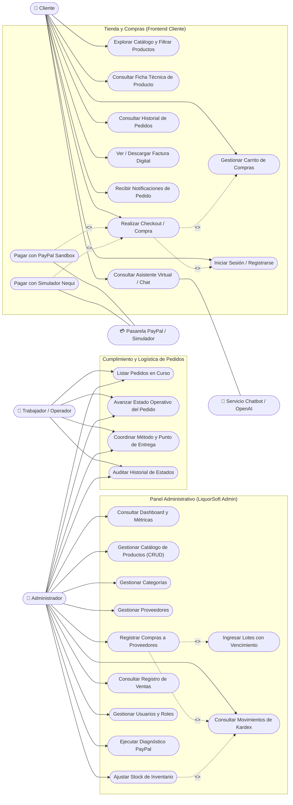
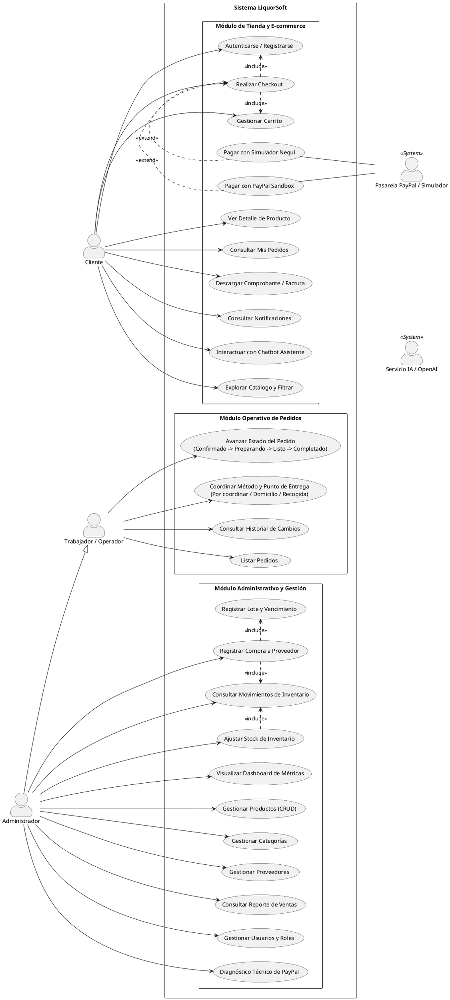

# Diagrama de Casos de Uso UML - LiquorSoft

Este documento describe y formaliza el **Diagrama de Casos de Uso UML** del sistema **LiquorSoft**, obtenido directamente del análisis del código fuente (rutas de Angular `app.routes.ts`, controladores de la API PHP en `backend/api/`, lógica de permisos en `AuthService` y `permission.guard.ts`, y roles del esquema de base de datos).

---

## 1. Actores del Sistema

A partir del modelo de roles y las rutas operativas reales del proyecto:

1. **Cliente / Comprador (E-commerce)**:
   - Usuario registrado con rol `Cliente` que navega el catálogo, compra licores, realiza pagos en línea y hace seguimiento a sus pedidos y notificaciones.
2. **Administrador**:
   - Usuario con rol `Administrador` que tiene control total sobre el catálogo de productos, inventario, compras a proveedores, ventas, asignación de pedidos, usuarios y diagnósticos técnicos.
3. **Trabajador / Operador de Pedidos**:
   - Usuario con rol `Trabajador` que interviene en la logística interna de pedidos: avanza los estados operativos (`PREPARANDO`, `LISTO_PARA_COORDINAR`, `COMPLETADO`) y coordina la forma de entrega (`POR_COORDINAR`, `DOMICILIO`, `RECOGIDA`).
4. **Pasarela de Pagos (PayPal Sandbox / Simulador Nequi)**:
   - Sistema externo que procesa intenciones de cobro, aprueba transacciones y devuelve códigos de captura e idempotencia.
5. **Servicio de Inteligencia Artificial (OpenAI / Asistente Local)**:
   - Servicio externo (o motor de reglas local de respaldo) para la asistencia conversacional y recomendación de productos en `chat.php`.

---

## 2. Diagrama de Casos de Uso (Formato Mermaid)

---

## 3. Diagrama de Casos de Uso (Formato PlantUML)

---

## 4. Descripción Detallada de Casos de Uso Clave

| ID | Caso de Uso | Actor Principal | Precondición | Flujo Principal / Resultado |
|---|---|---|---|---|
| **UC-05** | Realizar Checkout | Cliente | Carrito con ítems, usuario autenticado, confirmación mayor de 18 años. | Valida stock con bloqueo transaccional (`FOR UPDATE`), calcula total en COP/USD, descuenta stock y registra la venta, pedido y notificación. |
| **UC-06** | Pagar con PayPal | Cliente / PayPal | Credenciales Sandbox activas y clave de idempotencia de 36 caracteres. | Crea orden en PayPal API v2, captura cobro con idempotencia y valida que el monto pagado coincida exactamente con el carrito. |
| **UC-13** | Avanzar Estado de Pedido | Trabajador / Admin | Pedido con pago aprobado (`APROBADO` o `CAPTURADO`). | Transiciona: `CONFIRMADO` → `PREPARANDO` → `LISTO_PARA_COORDINAR` → `COMPLETADO`. Genera registro en `historial_pedido` y notificación al cliente. |
| **UC-14** | Coordinar Entrega | Trabajador / Admin | Pedido en estado `LISTO_PARA_COORDINAR`. | Define si la entrega es `DOMICILIO` o `RECOGIDA`, exigiendo la dirección o punto acordado en `fulfillmentDetails`. |
| **UC-20** | Registrar Compra | Administrador | Proveedor activo registrado. | Guarda encabezado en `compras`, renglones en `detalle_compra`, crea registro en `lotes`, suma stock en `productos` y crea `movimientos_inventario` tipo `ENTRADA`. |
| **UC-22** | Ajustar Stock | Administrador | Producto existente y motivo entre 3 y 200 caracteres. | Aplica ajuste en `productos.stock` y registra la justificación en `movimientos_inventario` (`ENTRADA` o `SALIDA`). |
