# Diagrama de Clases UML - LiquorSoft

Este documento contiene el **Diagrama de Clases UML** que modela la estructura lógica y arquitectónica del software LiquorSoft. El modelo refleja las clases, interfaces, tipos, métodos, propiedades y dependencias reales del código TypeScript (Angular 22) y la arquitectura de servicios/controladores en PHP 8.

---

## 1. Diagrama de Clases en Mermaid

```mermaid
classDiagram
    direction TB

    %% ==========================================
    %% MODELOS E INTERFACES DEL FRONTEND
    %% ==========================================
    class CurrentUser {
        <<interface>>
        +number id
        +string name
        +string email
        +string role
        +number roleId
    }

    class CartItem {
        <<interface>>
        +number id
        +string name
        +number price
        +string icon
        +string image
        +string category
        +number stock
        +number quantity
    }

    class PurchaseResponse {
        <<interface>>
        +boolean success
        +number saleId
        +number orderId
        +string orderNumber
        +number total
        +string paymentMethod
        +string paymentStatus
        +string orderStatus
        +boolean invoiceAvailable
        +string message
    }

    class PayPalOrderResponse {
        <<interface>>
        +string orderId
        +string currency
        +string amount
    }

    class Order {
        <<interface>>
        +number id
        +number total
        +string status
        +string createdAt
        +string paymentMethod
        +string paymentStatus
        +string invoiceUrl
        +OrderItem[] items
    }

    class OrderItem {
        <<interface>>
        +string name
        +number quantity
        +number price
    }

    %% ==========================================
    %% SERVICIOS DEL FRONTEND (ANGULAR INJECTABLE)
    %% ==========================================
    class AuthService {
        -HttpClient http
        -Router router
        +Signal~CurrentUser~ user
        +Signal~boolean~ loading
        -Observable refreshRequest
        +can(permission: string) boolean
        +isAdmin() boolean
        +isClient() boolean
        +refresh() Observable~CurrentUser~
        +logout() void
    }

    class CartService {
        -string storageKey
        +Signal~CartItem[]~ items
        +count() number
        +total() number
        +add(product: CartItem) boolean
        +decrease(product: CartItem) void
        +remove(product: CartItem) void
        +clear() void
        -persist(items: CartItem[]) void
        -read() CartItem[]
    }

    class PurchaseService {
        -HttpClient http
        +createPayPalOrder(items, key, address, birthDate, notes) Observable~PayPalOrderResponse~
        +checkout(items, method, outcome, key, address, birthDate, notes, paypalOrderId) Observable~PurchaseResponse~
    }

    class PaymentService {
        +string activeMethod
        +string simulatorOutcome
        +setMethod(method: string) void
    }

    class UserNotificationsService {
        -HttpClient http
        +Signal~NotificationItem[]~ notifications
        +Signal~number~ unreadCount
        +loadNotifications() void
        +markAsRead(id: number) void
    }

    class ThemeService {
        +Signal~string~ theme
        +toggle() void
        -applyTheme(theme: string) void
    }

    %% ==========================================
    %% COMPONENTES PRINCIPALES DEL FRONTEND
    %% ==========================================
    class CatalogoComponent {
        -HttpClient http
        -CartService cart
        +products: Product[]
        +categories: Category[]
        +selectedCategory: string
        +searchTerm: string
        +filterProducts() void
        +addToCart(product: Product) void
    }

    class CheckoutComponent {
        #CartService cart
        #AuthService auth
        #PaymentService payment
        -PurchaseService purchase
        #string method
        #string deliveryAddress
        #string birthDate
        #string notes
        +submitOrder() void
        +setupPayPalSdk() void
    }

    class PedidosComponent {
        -HttpClient http
        #AuthService auth
        #Order[] orders
        #boolean loading
        +loadOrders() void
        +formatPrice(val: number) string
    }

    class AdminShellComponent {
        +AuthService auth
        +ThemeService theme
        +logout() void
    }

    class AdminOrdersController {
        -mysqli connection
        +getOrders() JSON
        +updateOrderStatus(orderId, status, method, details) JSON
        -notifyCustomer(orderId, status) void
        -appendHistory(orderId, oldStatus, newStatus) void
    }

    class AdminInventoryController {
        -mysqli connection
        +getInventoryWithKardex() JSON
        +adjustStock(productId, quantity, reason) JSON
    }

    class AdminPurchasesController {
        -mysqli connection
        +getPurchases() JSON
        +createPurchase(supplierId, items, invoice, date, observation) JSON
    }

    %% ==========================================
    %% CONTROLADORES / SERVICIOS BACKEND PHP
    %% ==========================================
    class DatabaseConfig {
        <<backend>>
        +databaseConnection() mysqli
        +liquorsoftEnv(key: string, fallback: string) string
        +jsonResponse(status: int, payload: array) void
    }

    class SecurityMiddleware {
        <<backend>>
        +liquorsoftSessionStart() void
        +requireAuthenticatedUser() void
        +currentUser(conn: mysqli) array
        +requireRole(conn: mysqli, roles: array) array
        +issueCsrfCookie() void
        +requireCsrfToken() void
    }

    class PayPalGateway {
        <<backend>>
        +paypalConfiguration() array
        +paypalOAuthToken() array
        +paypalApiRequest(method, endpoint, body, headers) array
        +paypalOrderIsApproved(order, orderId, key, expectedUsd) bool
        +paypalCompletedCaptureId(order, orderId, key, expectedUsd) string
        +paypalAmountUsd(totalCents: int, copPerUsd: float) string
    }

    class CheckoutTransactionHandler {
        <<backend>>
        +processPurchase(payload: array) JSON
        -validateCartStock(conn: mysqli, items: array) array
        -createOrderRecord(conn: mysqli, userId: int, method: string) int
        -recordSaleAndInventoryMovement(conn: mysqli, orderId: int) int
        -dispatchNotifications(conn: mysqli, orderId: int) void
    }

    class InvoiceGenerator {
        <<backend>>
        +generateHtmlInvoice(orderId: int) HTML
        -calculateTaxBreakdown(total: float) array
    }

    class ChatbotAssistant {
        <<backend>>
        +processMessage(message: string) JSON
        -chatWithOpenAi(conn: mysqli, prompt: string, key: string) array
        -fallbackRuleEngine(conn: mysqli, normalized: string) array
    }

    %% ==========================================
    %% RELACIONES ENTRE CLASES
    %% ==========================================
    %% Frontend Dependencies
    CatalogoComponent --> CartService : usa
    CheckoutComponent --> CartService : inyecta
    CheckoutComponent --> AuthService : inyecta
    CheckoutComponent --> PurchaseService : inyecta
    CheckoutComponent --> PaymentService : inyecta
    PedidosComponent --> AuthService : inyecta
    PedidosComponent ..> Order : renderiza
    Order *-- OrderItem : contiene
    CartService *-- CartItem : almacena
    AuthService ..> CurrentUser : emite señal

    %% Backend Dependencies
    CheckoutTransactionHandler --> DatabaseConfig : conecta
    CheckoutTransactionHandler --> SecurityMiddleware : valida sesión y CSRF
    CheckoutTransactionHandler --> PayPalGateway : captura fondos
    AdminOrdersController --> DatabaseConfig : conecta
    AdminOrdersController --> SecurityMiddleware : verifica rol Trabajador/Admin
    AdminInventoryController --> DatabaseConfig : conecta
    AdminInventoryController --> SecurityMiddleware : verifica rol Admin
    AdminPurchasesController --> DatabaseConfig : conecta
    InvoiceGenerator --> DatabaseConfig : consulta
    InvoiceGenerator --> SecurityMiddleware : valida pertenencia
    ChatbotAssistant --> DatabaseConfig : consulta catálogo
```

---

## 2. Diagrama de Clases en PlantUML

```plantuml
@startuml
skinparam classAttributeIconSize 0
skinparam monochrome false
skinparam packageStyle frame

package "LiquorSoft Frontend (Angular TypeScript)" {
  interface CurrentUser {
    +id: number
    +name: string
    +email: string
    +role: string
    +roleId: number
  }

  interface CartItem {
    +id?: number
    +name: string
    +price: number
    +icon: string
    +image?: string
    +category?: string
    +stock?: number
    +quantity: number
  }

  interface OrderItem {
    +name: string
    +quantity: number
    +price: number
  }

  interface Order {
    +id: number
    +total: number
    +status: string
    +createdAt: string
    +paymentMethod: string
    +paymentStatus: string
    +invoiceUrl: string
    +items: OrderItem[]
  }

  class AuthService <<Injectable>> {
    -http: HttpClient
    -router: Router
    +user: Signal<CurrentUser>
    +loading: Signal<boolean>
    +can(permission: string): boolean
    +isAdmin(): boolean
    +isClient(): boolean
    +refresh(): Observable<CurrentUser>
    +logout(): void
  }

  class CartService <<Injectable>> {
    -storageKey: string
    +items: Signal<CartItem[]>
    +count(): number
    +total(): number
    +add(product: CartItem): boolean
    +decrease(product: CartItem): void
    +remove(product: CartItem): void
    +clear(): void
    -persist(items: CartItem[]): void
    -read(): CartItem[]
  }

  class PurchaseService <<Injectable>> {
    -http: HttpClient
    +createPayPalOrder(items, key, address, birthDate, notes): Observable
    +checkout(items, method, outcome, key, address, birthDate, notes, paypalOrderId): Observable
  }

  class CheckoutComponent <<Component>> {
    #cart: CartService
    #auth: AuthService
    -purchase: PurchaseService
    #method: string
    #deliveryAddress: string
    #birthDate: string
    #notes: string
    +submitOrder(): void
  }

  class CatalogoComponent <<Component>> {
    -http: HttpClient
    -cart: CartService
    +filterProducts(): void
    +addToCart(p: CartItem): void
  }

  class PedidosComponent <<Component>> {
    -http: HttpClient
    #auth: AuthService
    #orders: Order[]
    +loadOrders(): void
  }
}

package "LiquorSoft Backend (PHP Core & API)" {
  class DatabaseConfig {
    +databaseConnection(): mysqli
    +liquorsoftEnv(key: string, fallback: string): string
    +jsonResponse(status: int, payload: array): void
  }

  class SecurityMiddleware {
    +liquorsoftSessionStart(): void
    +requireAuthenticatedUser(): void
    +currentUser(conn: mysqli): array
    +requireRole(conn: mysqli, roles: array): array
    +issueCsrfCookie(): void
    +requireCsrfToken(): void
  }

  class PayPalGateway {
    +paypalConfiguration(): array
    +paypalOAuthToken(): array
    +paypalApiRequest(method, url, data, headers): array
    +paypalOrderIsApproved(order, orderId, key, usd): bool
    +paypalCompletedCaptureId(order, orderId, key, usd): string
    +paypalAmountUsd(cents: int, rate: float): string
  }

  class CheckoutHandler {
    +processPurchase(request: array): void
    -validateStock(conn: mysqli, items: array): array
    -persistOrder(conn: mysqli): int
    -recordSale(conn: mysqli): int
    -deductInventory(conn: mysqli): void
    -notifyStakeholders(conn: mysqli): void
  }

  class OrderAdminHandler {
    +getOrdersList(conn: mysqli): array
    +updateStatusAndFulfillment(conn: mysqli, id: int, status: string, method: string): void
  }

  class InvoiceHandler {
    +generatePdfOrHtml(conn: mysqli, orderId: int): string
  }

  class ChatHandler {
    +reply(conn: mysqli, prompt: string): array
  }
}

' Relaciones Frontend
AuthService ..> CurrentUser
CartService *-- CartItem
PedidosComponent ..> Order
Order *-- OrderItem
CheckoutComponent --> CartService
CheckoutComponent --> AuthService
CheckoutComponent --> PurchaseService
CatalogoComponent --> CartService

' Relaciones Backend
CheckoutHandler --> DatabaseConfig
CheckoutHandler --> SecurityMiddleware
CheckoutHandler --> PayPalGateway
OrderAdminHandler --> DatabaseConfig
OrderAdminHandler --> SecurityMiddleware
InvoiceHandler --> DatabaseConfig
ChatHandler --> DatabaseConfig
@enduml
```

---

## 3. Justificación de Diseño y Mapeo con el Código

1. **Frontend (Angular 22)**:
   - Los servicios utilizan **Signals** reactivas (`signal<T>`) para el estado compartido (`items`, `user`, `loading`, `unreadCount`), garantizando alto rendimiento y sincronización sin sobrecarga de suscripciones manuales.
   - La persistencia del carrito se delega en `localStorage` con validación estricta de esquema para evitar estados corruptos si el usuario recarga la pestaña.
   - Las rutas están protegidas por funciones guard modernas: `authGuard` (exige sesión activa) y `permissionGuard` (verifica capacidades específicas como `dashboard`, `productos`, `inventario`).
2. **Backend (PHP 8 + MySQLi)**:
   - Se diseñó como un conjunto de servicios modulares orientados a dominio (`CheckoutHandler`, `OrderAdminHandler`, `PayPalGateway`, `SecurityMiddleware`).
   - El manejo transaccional (`begin_transaction()`, `commit()`, `rollback()`) asegura la integridad de los datos financieros y de inventario durante el proceso de compra.
   - La autenticación utiliza sesiones nativas en servidor con cookies protegidas (`HttpOnly`, `SameSite=Lax/Strict`), complementadas por tokens CSRF de doble envío (`liquorsoft_csrf` cookie + cabecera `X-CSRF-Token`).
