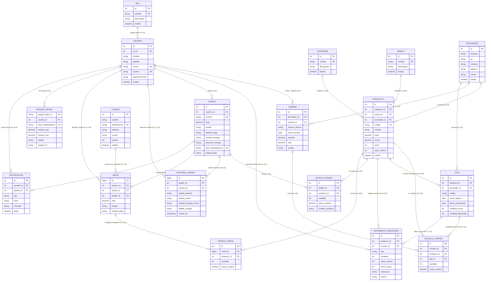
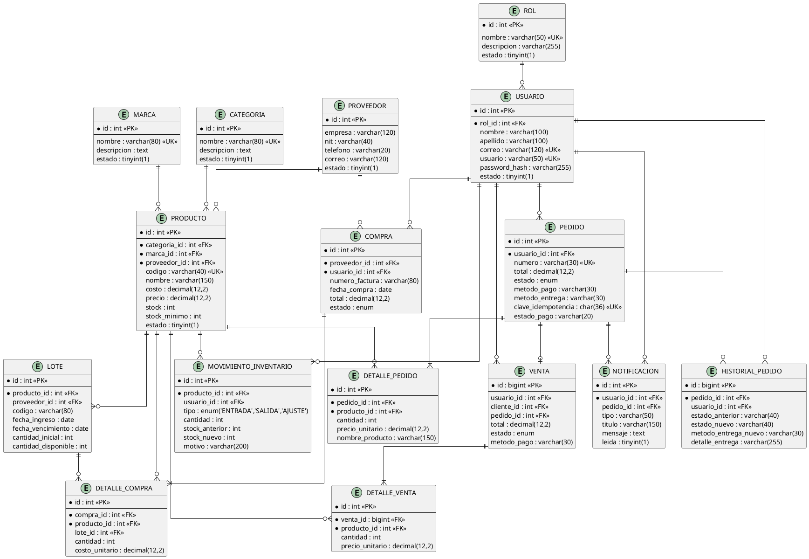

# Diagrama Entidad-Relación (E-R) - LiquorSoft

Este documento presenta el **Diagrama Entidad-Relación (E-R)** conceptual y lógico del sistema **LiquorSoft**. Se deriva exclusivamente de las tablas, claves foráneas y flujos de datos reales implementados en `backend/database/schema.sql` y las migraciones de `backend/database/migrations/`.

---

## 1. Definición de Entidades del Dominio

| Entidad | Tipo | Propósito en el Negocio |
|---|---|---|
| **ROL** | Fuerte | Define los perfiles y permisos de acceso (Administrador, Trabajador, Cliente, etc.). |
| **USUARIO** | Fuerte | Almacena las cuentas autenticables para clientes de la tienda y personal operativo. |
| **CLIENTE** | Fuerte | Registro de terceros/compradores para ventas de mostrador y fidelización por puntos. |
| **CATEGORIA** | Fuerte | Clasificación de licores (Licores, Vinos, Cervezas, Mixers). |
| **MARCA** | Fuerte | Identificación de la casa comercial fabricante de los licores. |
| **PROVEEDOR** | Fuerte | Empresas distribuidoras a quienes se compran los productos y lotes. |
| **PRODUCTO** | Fuerte | Catálogo de bebidas alcohólicas con stock, precios, contenido y graduación. |
| **LOTE** | Débil | Trazabilidad de existencias por fecha de ingreso y fecha de vencimiento. |
| **COMPRA** | Fuerte | Registro de adquisición de mercancía ante un proveedor. |
| **DETALLE_COMPRA** | Débil | Renglones de productos, cantidades y costos asociados a una compra. |
| **MOVIMIENTO_INVENTARIO**| Débil | Kardex de movimientos de stock (ENTRADA, SALIDA, AJUSTE) con justificación. |
| **PEDIDO** | Fuerte | Órdenes de compra generadas por los usuarios desde la tienda virtual. |
| **DETALLE_PEDIDO** | Débil | Ítems de productos y precios unitarios históricos vinculados a un pedido. |
| **HISTORIAL_PEDIDO** | Débil | Registro cronológico y auditoría de transiciones de estado y entrega de un pedido. |
| **VENTA** | Fuerte | Facturación y liquidación contable de órdenes completadas o ventas directas. |
| **DETALLE_VENTA** | Débil | Líneas de producto y valor cobrado en una venta formal. |
| **INTENTO_PAYPAL** | Débil | Control de idempotencia y captura de órdenes en la pasarela PayPal Sandbox. |
| **NOTIFICACION** | Débil | Alertas enviadas a usuarios y administradores sobre estados de compra. |

---

## 2. Diagrama Entidad-Relación (Mermaid con Notación Crow's Foot)

---

## 3. Diagrama E-R en PlantUML

---

## 4. Cardinalidades y Reglas de Negocio E-R

1. **Un Usuario pertenece exactamente a un Rol** (`ROL 1:N USUARIO`). Los usuarios que compran en la tienda se auto-registran con el rol `Cliente` (id 6). Los usuarios operativos (`Administrador`, `Trabajador`, etc.) son gestionados por el administrador.
2. **Un Producto pertenece a una Categoría, una Marca y un Proveedor** (`1:N`). Si una categoría o proveedor se elimina, se bloquea la operación (`ON DELETE RESTRICT`) para no dejar productos huérfanos.
3. **Control estricto de Lotes y Vencimientos** (`PRODUCTO 1:N LOTE 0..1:N DETALLE_COMPRA`): Al ingresar compras, se generan lotes con fecha de vencimiento y existencias disponibles para garantizar rotación por fecha.
4. **Desacoplamiento entre Pedido y Venta** (`PEDIDO 0..1:1 VENTA`): Un pedido pasa por estados preparatorios (`PENDIENTE`, `CONFIRMADO`, `PREPARANDO`). Solo cuando el pago es aprobado/capturado se genera el registro contable en `VENTA`, se descuenta el stock en `PRODUCTO` y se emite el movimiento de Kardex en `MOVIMIENTO_INVENTARIO`.
5. **Auditoría e Historial de Cumplimiento** (`PEDIDO 1:N HISTORIAL_PEDIDO`): Cada avance de estado o acuerdo en la forma de entrega (`POR_COORDINAR` -> `DOMICILIO`/`RECOGIDA`) registra el actor, la fecha exacta y las notas de entrega acordadas.
