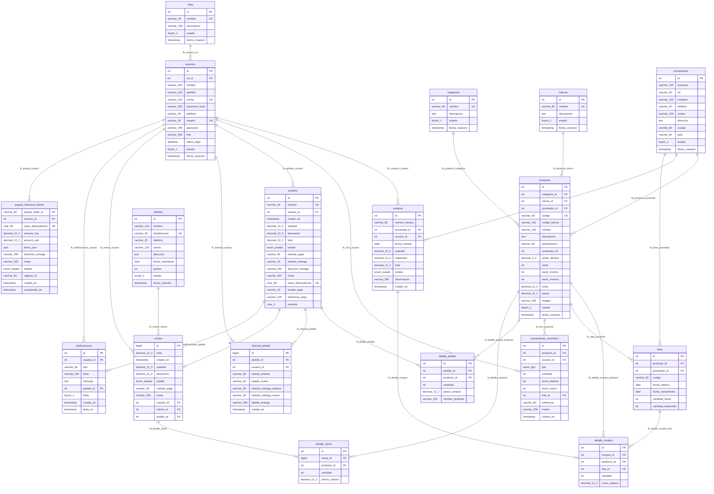

# Modelo Relacional de la Base de Datos - LiquorSoft

Este documento detalla el **Modelo Relacional Físico** de la base de datos de **LiquorSoft** (MySQL 8+ / MariaDB 10.4+ InnoDB, charset `utf8mb4_unicode_ci`).

---

## 1. Diagrama Físico del Modelo Relacional (Mermaid)

---

## 2. Esquema Relacional Formal (Notación de Álgebra Relacional / Codd)

Las claves primarias se indican con **`[PK]`**, las foráneas con **`[FK -> Tabla.columna]`** y los campos con restricción de unicidad con **`[UK]`**:

1. **`roles`** (
   **id** `[PK]`, nombre `[UK]`, descripcion, estado, fecha_creacion
)
2. **`usuarios`** (
   **id** `[PK]`, *rol_id* `[FK -> roles.id]`, nombre, apellido, correo `[UK]`, password_hash, telefono, usuario `[UK]`, password, foto, ultimo_login, estado, fecha_creacion
)
3. **`clientes`** (
   **id** `[PK]`, nombre, identificacion `[UK]`, telefono, correo, direccion, fecha_nacimiento, puntos, estado, fecha_creacion
)
4. **`categorias`** (
   **id** `[PK]`, nombre `[UK]`, descripcion, estado, fecha_creacion
)
5. **`marcas`** (
   **id** `[PK]`, nombre `[UK]`, descripcion, estado, fecha_creacion
)
6. **`proveedores`** (
   **id** `[PK]`, empresa, nit, contacto, telefono, correo, direccion, ciudad, pais, estado, fecha_creacion
)
7. **`productos`** (
   **id** `[PK]`, *categoria_id* `[FK -> categorias.id]`, *marca_id* `[FK -> marcas.id]`, *proveedor_id* `[FK -> proveedores.id]`, codigo `[UK]`, codigo_barras, nombre, descripcion, presentacion, contenido_ml, grado_alcohol, stock, stock_minimo, stock_maximo, costo, precio, imagen, estado, fecha_creacion
)
8. **`lotes`** (
   **id** `[PK]`, *producto_id* `[FK -> productos.id]`, *proveedor_id* `[FK -> proveedores.id]`, codigo, fecha_ingreso, fecha_vencimiento, cantidad_inicial, cantidad_disponible
)
9. **`movimientos_inventario`** (
   **id** `[PK]`, *producto_id* `[FK -> productos.id]`, *usuario_id* `[FK -> usuarios.id]`, tipo, cantidad, stock_anterior, stock_nuevo, *lote_id* `[FK -> lotes.id]`, referencia, motivo, creado_en
)
10. **`compras`** (
    **id** `[PK]`, numero_factura, *proveedor_id* `[FK -> proveedores.id]`, *usuario_id* `[FK -> usuarios.id]`, fecha_compra, subtotal, impuestos, total, estado, observacion, creado_en
)
11. **`detalle_compra`** (
    **id** `[PK]`, *compra_id* `[FK -> compras.id ON DELETE CASCADE]`, *producto_id* `[FK -> productos.id]`, *lote_id* `[FK -> lotes.id ON DELETE SET NULL]`, cantidad, costo_unitario
)
12. **`pedidos`** (
    **id** `[PK]`, numero `[UK]`, *usuario_id* `[FK -> usuarios.id]`, creado_en, subtotal, descuento, total, estado, metodo_pago, metodo_entrega, direccion_entrega, notas, clave_idempotencia `[UK]`, estado_pago, referencia_pago, moneda
)
13. **`detalle_pedido`** (
    **id** `[PK]`, *pedido_id* `[FK -> pedidos.id ON DELETE CASCADE]`, *producto_id* `[FK -> productos.id]`, cantidad, precio_unitario, nombre_producto
)
14. **`historial_pedido`** (
    **id** `[PK]`, *pedido_id* `[FK -> pedidos.id ON DELETE CASCADE]`, *usuario_id* `[FK -> usuarios.id ON DELETE SET NULL]`, estado_anterior, estado_nuevo, metodo_entrega_anterior, metodo_entrega_nuevo, detalle_entrega, creado_en
)
15. **`ventas`** (
    **id** `[PK]`, total, creado_en, subtotal, descuento, estado, metodo_pago, notas, *usuario_id* `[FK -> usuarios.id]`, *cliente_id* `[FK -> clientes.id]`, *pedido_id* `[FK -> pedidos.id]`
)
16. **`detalle_venta`** (
    **id** `[PK]`, *venta_id* `[FK -> ventas.id]`, *producto_id* `[FK -> productos.id]`, cantidad, precio_unitario
)
17. **`paypal_checkout_intents`** (
    **paypal_order_id** `[PK]`, *usuario_id* `[FK -> usuarios.id]`, clave_idempotencia `[UK (usuario_id, clave_idempotencia)]`, amount_cop, amount_usd, items_json, direccion_entrega, notas, estado, capture_id, creado_en, actualizado_en
)
18. **`notificaciones`** (
    **id** `[PK]`, *usuario_id* `[FK -> usuarios.id ON DELETE CASCADE]`, tipo, titulo, mensaje, *pedido_id* `[FK -> pedidos.id ON DELETE SET NULL]`, leida, creado_en, leida_en
)

---

## 3. Matriz de Integridad Referencial y Restricciones Físicas

| Tabla Origen (Foreign Key) | Columna FK | Tabla Destino | Columna PK | Acción ON DELETE | Acción ON UPDATE |
|---|---|---|---|---|---|
| `usuarios` | `rol_id` | `roles` | `id` | RESTRICT | CASCADE |
| `productos` | `categoria_id` | `categorias` | `id` | RESTRICT | CASCADE |
| `productos` | `marca_id` | `marcas` | `id` | RESTRICT | CASCADE |
| `productos` | `proveedor_id` | `proveedores` | `id` | RESTRICT | CASCADE |
| `compras` | `proveedor_id` | `proveedores` | `id` | RESTRICT | NO ACTION |
| `compras` | `usuario_id` | `usuarios` | `id` | RESTRICT | NO ACTION |
| `detalle_compra` | `compra_id` | `compras` | `id` | **CASCADE** | NO ACTION |
| `detalle_compra` | `producto_id` | `productos` | `id` | RESTRICT | NO ACTION |
| `detalle_compra` | `lote_id` | `lotes` | `id` | **SET NULL** | NO ACTION |
| `lotes` | `producto_id` | `productos` | `id` | RESTRICT | NO ACTION |
| `lotes` | `proveedor_id` | `proveedores` | `id` | **SET NULL** | NO ACTION |
| `detalle_pedido` | `pedido_id` | `pedidos` | `id` | **CASCADE** | NO ACTION |
| `detalle_pedido` | `producto_id` | `productos` | `id` | RESTRICT | NO ACTION |
| `historial_pedido` | `pedido_id` | `pedidos` | `id` | **CASCADE** | NO ACTION |
| `historial_pedido` | `usuario_id` | `usuarios` | `id` | **SET NULL** | NO ACTION |
| `notificaciones` | `usuario_id` | `usuarios` | `id` | **CASCADE** | NO ACTION |
| `notificaciones` | `pedido_id` | `pedidos` | `id` | **SET NULL** | NO ACTION |
| `ventas` | `pedido_id` | `pedidos` | `id` | SET NULL / NO ACTION | NO ACTION |
| `ventas` | `usuario_id` | `usuarios` | `id` | SET NULL / NO ACTION | NO ACTION |
| `detalle_venta` | `venta_id` | `ventas` | `id` | NO ACTION | NO ACTION |
| `detalle_venta` | `producto_id` | `productos` | `id` | RESTRICT | NO ACTION |

---

## 4. Índices de Rendimiento y Llaves Únicas

1. **`pedidos.uq_pedidos_idempotencia`** (`clave_idempotencia`): Previene pagos dobles ante reintentos de red del cliente.
2. **`paypal_checkout_intents.uq_paypal_intent_usuario_idempotencia`** (`usuario_id`, `clave_idempotencia`): Asocia unívocamente la orden de PayPal al carrito del usuario.
3. **`notificaciones.idx_notificaciones_usuario_leida`** (`usuario_id`, `leida`, `creado_en`): Optimiza la consulta en tiempo real de la campana de notificaciones.
4. **`historial_pedido.idx_historial_pedido_fecha`** (`pedido_id`, `creado_en`): Acelera la reconstrucción de la línea de tiempo del pedido en el panel administrativo.
5. **`lotes.idx_lotes_vencimiento`** (`fecha_vencimiento`): Permite priorizar la salida de inventario por fecha de expiración próxima.
