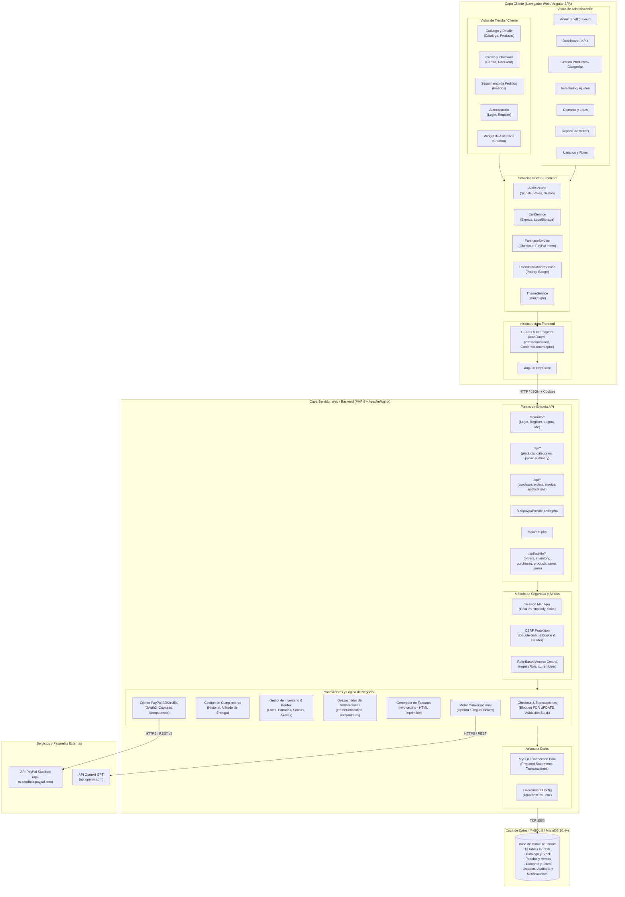
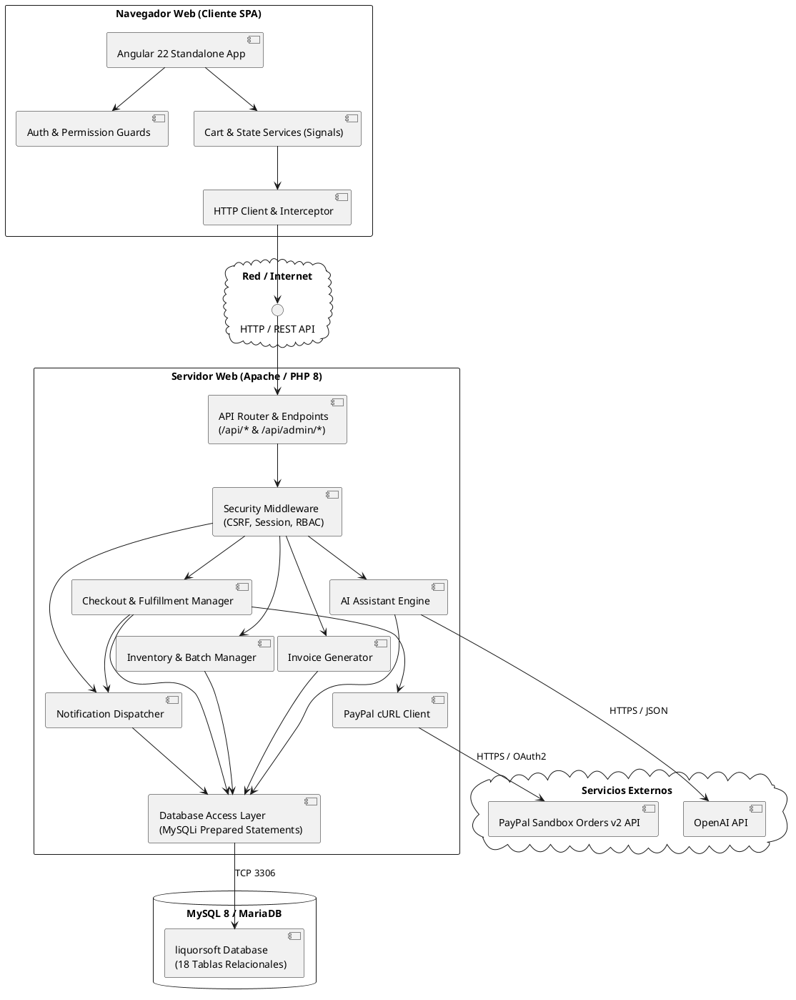

# Diagrama de Arquitectura y Componentes - LiquorSoft

Este documento describe la **Arquitectura de Software** y el **Diagrama de Componentes** de **LiquorSoft**, reflejando la distribución en capas (Frontend SPA, Backend API RESTful en PHP, Base de Datos MySQL/MariaDB y Servicios Externos).

---

## 1. Visión General de la Arquitectura

LiquorSoft implementa un patrón desacoplado **Cliente-Servidor (SPA + API REST)**:

1. **Capa de Presentación (Frontend SPA)**:
   - Construida con **Angular 22** (arquitectura standalone, TypeScript, Angular Signals para reactividad, y enrutamiento con protección de guardias).
   - Empaquetada como archivos estáticos (`dist/`) que se sirven a través del servidor web.
2. **Capa de Aplicación y Servicios (Backend API)**:
   - Desarrollada en **PHP 8** con tipado estricto (`declare(strict_types=1)`).
   - Expone endpoints REST en formato JSON.
   - Gestiona autenticación basada en sesiones seguras del servidor (`PHPSESSID`), tokens CSRF (`X-CSRF-Token`) y control de acceso basado en roles (RBAC).
3. **Capa de Persistencia (Base de Datos Relacional)**:
   - Motor **MySQL 8.0 / MariaDB 10.4+** con motor de almacenamiento **InnoDB**.
   - Garantiza consistencia transaccional (ACID), claves foráneas con restricciones de integridad y aislamiento con bloqueo pesimista (`FOR UPDATE`).
4. **Capa de Integraciones Externas**:
   - **PayPal Sandbox API**: Autenticación OAuth 2.0 y gestión de órdenes v2.
   - **OpenAI API**: Asistente conversacional con mecanismo de contingencia (*fallback*) a motor de reglas local.

---

## 2. Diagrama de Componentes del Sistema (Mermaid)

---

## 3. Diagrama de Arquitectura de Componentes en PlantUML

---

## 4. Desglose de Capas y Responsabilidades

### A. Capa Frontend (Angular 22 SPA)
- **Desacoplamiento total**: No se incluye renderizado por servidor (SSR); el bundle estático se ejecuta completamente en el navegador.
- **Manejo de estado**: Basado en **Angular Signals**, lo que proporciona un flujo unidireccional y reactivo sin estados mutables descontrolados.
- **Protección de rutas**: 
  - `authGuard`: Redirige a `/login` si no hay sesión activa.
  - `permissionGuard`: Comprueba si el rol del usuario cuenta con el permiso requerido (`dashboard`, `productos`, `inventario`, `ventas`, `compras`, `proveedores`, `usuarios`).

### B. Capa de Servicios y Lógica de Negocio (Backend PHP)
- **Seguridad en capas**:
  - `requireRole($conn, $roles)`: Verifica privilegios en cada endpoint antes de ejecutar cualquier consulta.
  - `requireCsrfToken()`: Compara la cookie `liquorsoft_csrf` con la cabecera `X-CSRF-Token` para bloquear ataques de tipo falsificación de petición en sitios cruzados.
  - `password_hash()` y `password_verify()`: Criptografía estándar para credenciales de acceso.
- **Transacciones y Concurrencia**:
  - `purchase.php` y `admin/inventory.php` emplean `begin_transaction()` y `SELECT ... FOR UPDATE` para evitar problemas de concurrencia y sobreventa de stock.

### C. Capa de Almacenamiento (MySQL 8 / MariaDB)
- **Persistencia Transaccional**: Tablas de órdenes, ventas, detalles y movimientos operan bajo InnoDB.
- **Integridad y Auditoría**: Tablas como `historial_pedido` y `movimientos_inventario` retienen la trazabilidad operativa histórica, incluso si otros registros cambian.

### D. Capa de Servicios Externos
- **PayPal Sandbox**: El backend orquesta la creación y captura de las órdenes usando identificadores de idempotencia únicos (`UUIDv4`).
- **OpenAI**: Asistente virtual para responder consultas sobre licores y recomendaciones. Si la clave no está configurada o hay fallos de red, el sistema activa automáticamente un motor de expresiones regulares local para mantener la disponibilidad.
